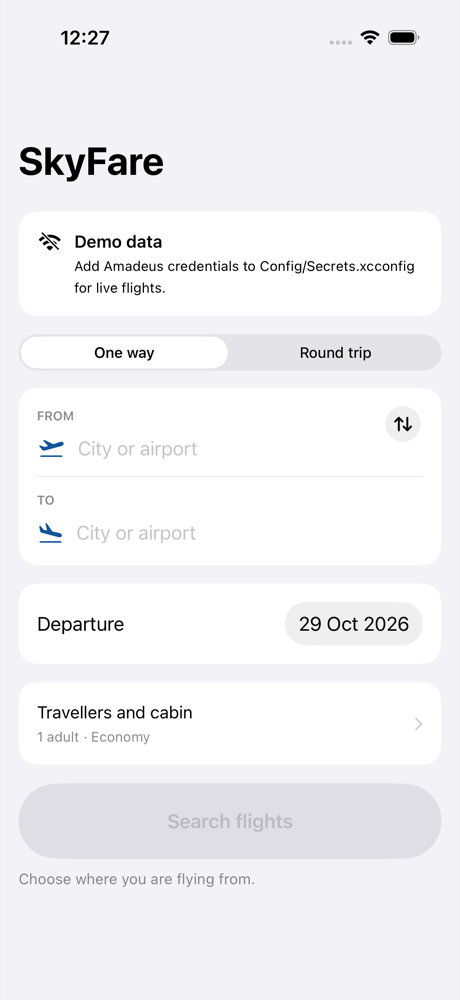
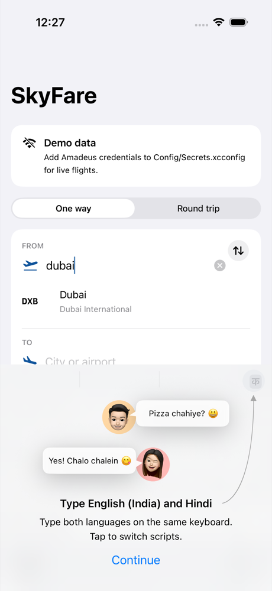
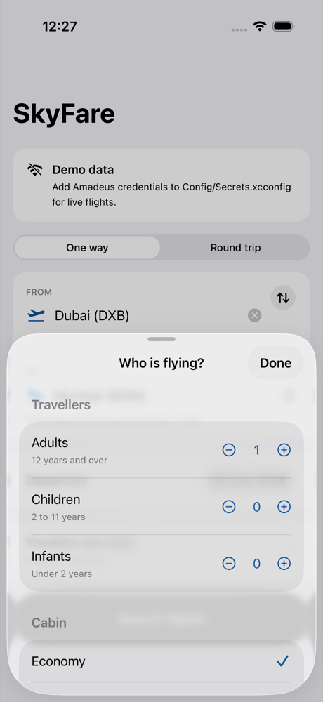
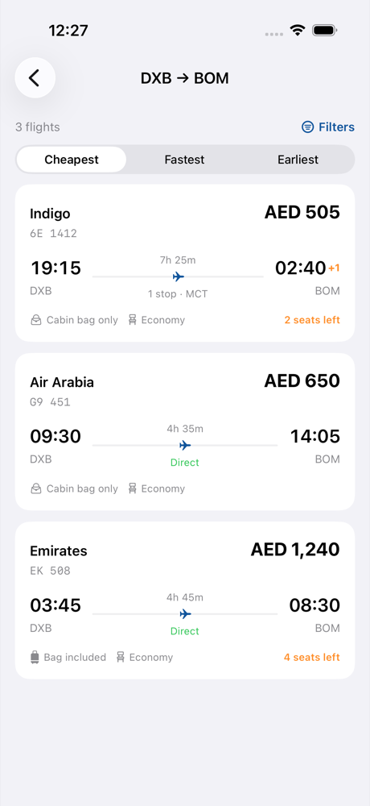
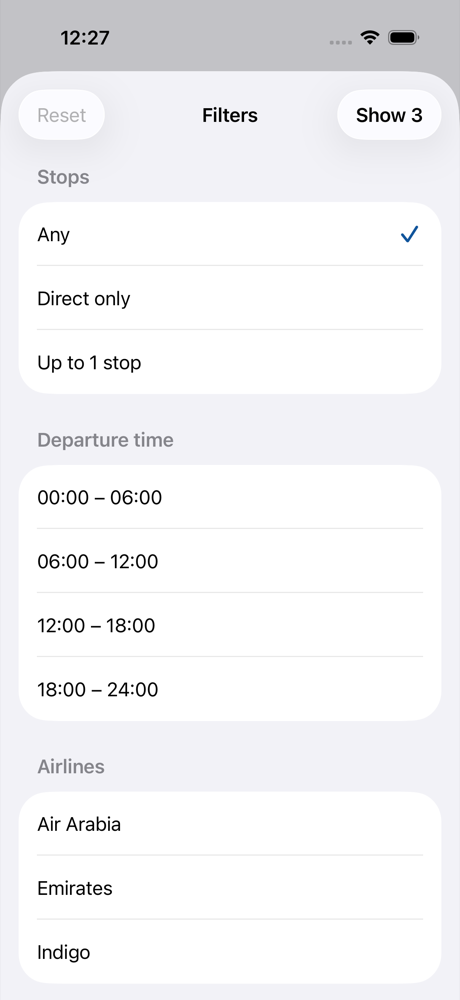

# SkyFare

[](https://github.com/nimish-khandelwal/skyfare-ios/actions/workflows/ci.yml)


A native iOS flight booking app built on the **Amadeus Self-Service GDS APIs** — the same
flight-offer data model real travel agencies and airlines work with.

| Search | Autocomplete | Travellers | Results | Filters |
| --- | --- | --- | --- | --- |
|  |  |  |  |  |

---

## Status

🚧 **In active development.** The search-to-results journey is complete and tested;
booking is next.

**Working today**

- Live flight search against the Amadeus `v2/shopping/flight-offers` endpoint
- Airport and city autocomplete, debounced through Combine
- Round-trip and one-way searches, cabin selection, traveller rules enforced client-side
- Results list with sorting (cheapest / fastest / earliest) and filtering by stops, airline,
  departure window and checked baggage
- Offline demo mode so the app runs with no API credentials at all
- 120 unit tests and 7 XCUITests, 94% coverage, zero compiler warnings under Swift 6
  strict concurrency
- CI on every push, plus Fastlane lanes for testing and screenshot capture

**Roadmap**

- [ ] Fare families (Basic / Value / Flex) on the offer detail screen
- [ ] Seat map — custom `UICollectionViewLayout`, pricing tiers, exit rows
- [ ] Passenger details form with passport validation
- [ ] Ancillaries (baggage, meals, insurance) with live cart totals
- [ ] Payment and PNR confirmation
- [ ] My Trips: offline storage via SwiftData, QR boarding pass
- [ ] Push notifications for flight status, deep linked into the trip
- [ ] Universal Links (`skyfare://booking/<PNR>`)
- [ ] English and Arabic localisation with full RTL layout

---

## Why I built it

I wanted to work with real airline data rather than a toy REST API. Amadeus turned out to be
a good teacher: its flight-offer payload is deeply nested and polymorphic, prices arrive as
strings, durations as ISO-8601 (`PT3H5M`), airline and aircraft names live in a separate
`dictionaries` block you have to join yourself, and one of the JSON keys is `class` — a
reserved word in Swift. Handling all of that cleanly is most of what this project is about.

---

## Architecture

MVVM with a coordinator for navigation, and protocol-backed repositories so every layer can
be tested without a network.

```
┌─────────────┐   @Published    ┌──────────────┐   async/await   ┌──────────────┐
│    View     │ ◄─────────────► │  ViewModel   │ ◄──────────────►│  Repository  │
│  (SwiftUI)  │    bindings     │  (@MainActor)│                 │  (protocol)  │
└─────────────┘                 └──────────────┘                 └──────┬───────┘
       │                                                                │
       │ routes                                                         │
       ▼                                                                ▼
┌─────────────┐                                                 ┌──────────────┐
│ Coordinator │                                                 │  APIClient   │
│ NavigationS.│                                                 │   (generic)  │
└─────────────┘                                                 └──────┬───────┘
                                                                       │
                                               ┌───────────────────────┴────────┐
                                               ▼                                ▼
                                     ┌──────────────────┐            ┌──────────────────┐
                                     │  TokenProvider   │            │   HTTPSession    │
                                     │     (actor)      │            │   (protocol)     │
                                     └──────────────────┘            └──────────────────┘
```

**Why these choices**

- **ViewModels are `@MainActor` classes, repositories are `Sendable` protocols.** The UI layer
  is single-threaded by construction; everything below it is concurrency-safe by contract. The
  project compiles with `SWIFT_STRICT_CONCURRENCY=complete` and no warnings.
- **Combine where it earns its place.** Airport autocomplete is
  `$form → map → removeDuplicates → debounce → request`, which collapses a burst of keystrokes
  into one network call. Form validation is a second pipeline that publishes straight into
  `canSearch`. Everything below the view model uses `async`/`await` instead.
- **The token provider is an actor.** Eight concurrent callers share a single OAuth2 refresh
  rather than firing eight token requests — there is a test that asserts exactly this.
- **`HTTPSession` is a protocol.** `URLSession` conforms to it in production; tests inject a
  stub that returns recorded JSON, so the whole networking stack is exercised without a server.
- **Wire types and domain types are separate.** `FlightOfferPayload` mirrors Amadeus exactly;
  `FlightOffer` is what the UI wants. `FlightOfferMapper` sits between them and resolves the
  `dictionaries` block, so airline codes become airline names in one place.
- **Validation lives in a plain struct.** `FlightSearchForm` holds the search inputs and the
  rules that govern them, with no Combine or UIKit imports, so the rules are tested directly.

### Project layout

```
SkyFare/
├── App/              entry point, dependency graph, offline sample data
├── Core/
│   ├── Networking/   APIClient, Endpoint, APIError, HTTPSession
│   ├── Auth/         AmadeusTokenProvider (actor)
│   ├── Config/       credential resolution
│   └── Extensions/   ISO-8601 durations, date decoding, formatting
├── Features/
│   ├── Search/       form model, repositories, view model, views
│   └── Results/      offer models, mapper, filtering, view model, views
└── Navigation/       AppCoordinator, AppRoute
```

---

## Running it

```bash
git clone https://github.com/nimish-khandelwal/skyfare-ios.git
cd skyfare-ios
brew install xcodegen
xcodegen generate
open SkyFare.xcodeproj
```

The app runs straight away in **demo mode** with bundled sample flights, so you can build and
browse without signing up for anything.

For live flight data, create a free sandbox account at
[developers.amadeus.com](https://developers.amadeus.com), then:

```bash
cp Config/Secrets.xcconfig.example Config/Secrets.xcconfig
# paste your Client ID and Client Secret into the new file
```

`Config/Secrets.xcconfig` is git-ignored. Credentials can also come from the environment
(`AMADEUS_CLIENT_ID`, `AMADEUS_CLIENT_SECRET`), which is how CI would inject them.

---

## Testing

```bash
bundle install
bundle exec fastlane test          # unit + UI tests, prints coverage
bundle exec fastlane unit_tests    # unit tests only
bundle exec fastlane screenshots   # regenerates docs/screenshots
```

| Suite | Tests | What it covers |
| --- | --- | --- |
| Networking and auth | 34 | URL building, bearer injection, 401 retry-once, 429 `Retry-After`, Amadeus error envelopes, token caching, refresh coalescing across 8 concurrent callers |
| Decoding and mapping | 11 | Real Amadeus fixtures, the `class` reserved keyword, mixed date formats, dictionary joins, malformed-price rejection |
| Form and validation | 23 | Date rules, traveller limits, infant-per-adult rule, swap, query building |
| View models and filtering | 38 | Debounce collapsing keystrokes, suggestion lifecycle, search states, sorting, filter composition |
| Formatting and parsing | 14 | ISO-8601 durations, duration and price display |
| UI (XCUITest) | 7 | Disabled-until-valid search, full search journey, passenger sheet rules, airline filtering, sorting, screenshot capture |

Coverage is **94%** across the app target and **93%** across the logic layer
(models, view models, networking) measured by `xccov`.

---

## CI/CD

GitHub Actions runs on every push and pull request: generates the project with XcodeGen,
resolves an available simulator at runtime, runs the unit and UI suites separately, and prints
the coverage report. Result bundles are uploaded as artifacts when a run fails.

Fastlane holds the same commands for local use, plus a `beta` lane that builds and uploads to
TestFlight. That lane needs signing credentials (`SKYFARE_TEAM_ID`, `SKYFARE_APPLE_ID`) which
are not part of this repository.

---

## Notes

Built with Xcode 27 and Swift 6, targeting iOS 17 and above. The Xcode project is generated
from `project.yml` by [XcodeGen](https://github.com/yonaskolb/XcodeGen) and is not committed,
so there are no `.pbxproj` merge conflicts.

SkyFare is a personal learning project and is not affiliated with any airline.
